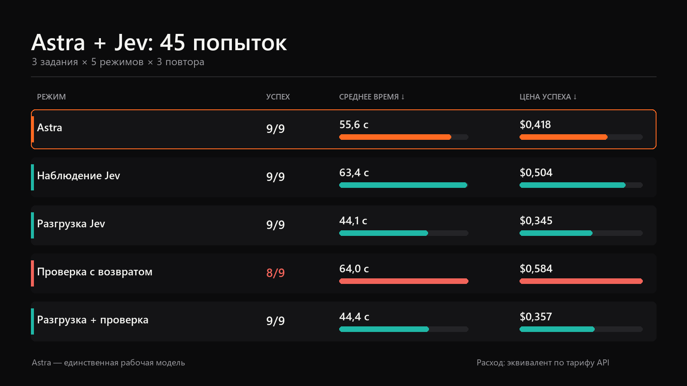
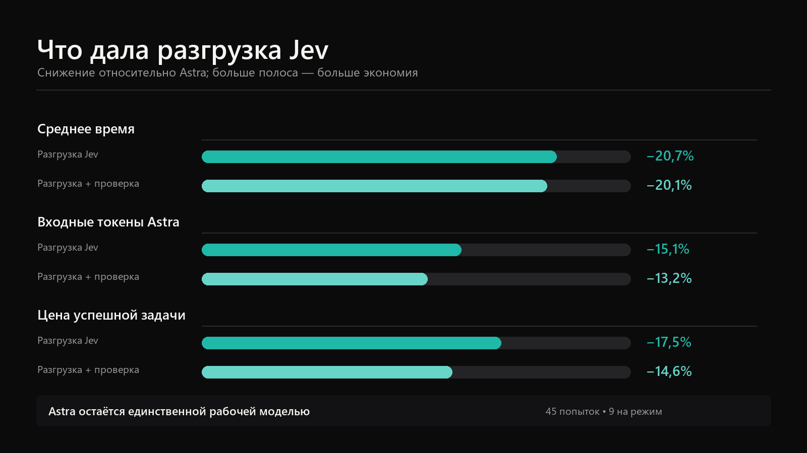
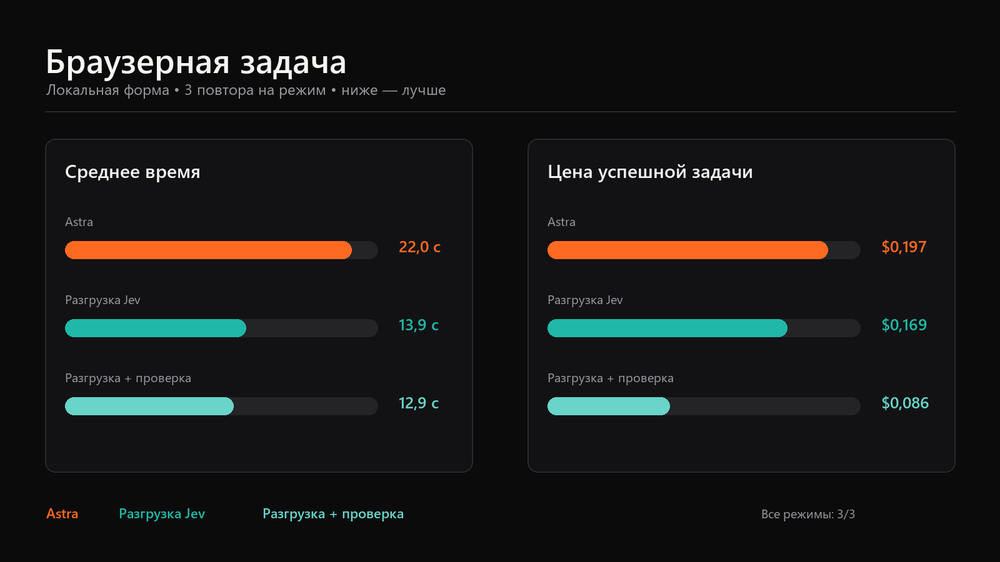

# Astra + Jev Benchmark

Воспроизводимое сравнение Astra и Astra с Jev на задачах написания кода, исправления ошибки и работы с локальной браузерной формой.

Замер относится к изолированному Codex CLI: одна модель `gpt-6-astra`, уровень рассуждения `xhigh`, отключённые пользовательские дополнения, перехватчики, приложения, память и параллельные агенты. Jev не переключает задачу на Luna, Terra или Sol. Он принимает короткие решения из заранее заданного списка, а работу выполняет Astra.

## Короткий вывод

Полная серия включала 45 попыток: три задания, пять режимов и три повтора каждого сочетания.

| Режим | Успешно | Среднее время | Общий расход | Цена успешной задачи |
|---|---:|---:|---:|---:|
| Astra | 9/9 | 55,6 с | $3,764 | $0,418 |
| Наблюдение Jev | 9/9 | 63,4 с | $4,534 | $0,504 |
| Разгрузка Jev | 9/9 | 44,1 с | $3,107 | $0,345 |
| Проверка с возвратом | 8/9 | 64,0 с | $4,672 | $0,584 |
| Разгрузка + проверка | 9/9 | 44,4 с | $3,214 | $0,357 |



На этом наборе режим разгрузки дал лучший результат:

- среднее время уменьшилось на 20,7%;
- входные токены Astra уменьшились на 15,1%;
- цена успешной задачи уменьшилась на 17,5%;
- успешность сохранилась: 9/9.

Совмещённый режим добавил итоговую проверку Jev и сохранил большую часть экономии: время уменьшилось на 20,1%, входные токены Astra — на 13,2%, цена успешной задачи — на 14,6%. Успешность составила 9/9.



Наблюдение после завершения задачи увеличило цену успешного результата на 20,5%. Проверка с возвратом увеличила её на 39,6% и получила 8 успешных результатов из 9. Дополнительные обращения к Jev сами по себе не дали экономии; она появилась, когда Jev выбирал ограниченную стратегию до запуска Astra.

## Чем отличаются режимы

| Режим | До Astra | После Astra | Повтор Astra |
|---|---|---|---:|
| `astra_only` | Jev не вызывается | Обязательная локальная проверка | Нет |
| `astra_jev_observe` | Jev не вызывается | Jev оценивает доказательства и записывает вердикт без изменения результата | Нет |
| `astra_jev_offload` | Jev выбирает разрешённую стратегию или браузерное действие | Обязательная локальная проверка | Нет |
| `astra_jev_guarded` | Astra выбирает способ решения | Провал проверки или вердикт Jev может вернуть задачу на исправление | Один |
| `astra_jev_offload_guarded` | Jev выбирает стратегию перед каждым проходом | Локальная проверка отсеивает фактический провал, затем Jev принимает результат или назначает исправление | Один |

Разрешённые ответы Jev задаются каждым заданием. Произвольную команду оболочки или новый инструмент он выбрать не может.

## Задания

В серии использовались три небольших задания:

1. **Написание кода** — реализовать `slugify` по заданным требованиям и пройти тесты.
2. **Исправление ошибки** — исправить `clamp.py`, не меняя защищённый тестовый файл.
3. **Браузерная форма** — извлечь значение, заполнить локальную страницу и подтвердить состояние `submitted`.

Каждая попытка получала новую копию исходных файлов. Режимы не использовали результаты друг друга. Порядок режимов сдвигался между повторами, чтобы постоянное первое место не давало одному режиму преимущество от прогрева кэша.

## Разбивка по заданиям

| Задание | Режим | Успешно | Среднее время | Цена успешной задачи |
|---|---|---:|---:|---:|
| Написание кода | Astra | 3/3 | 66,7 с | $0,453 |
| Написание кода | Наблюдение | 3/3 | 87,6 с | $0,580 |
| Написание кода | Разгрузка | 3/3 | 55,7 с | $0,387 |
| Написание кода | Проверка | 3/3 | 68,2 с | $0,456 |
| Написание кода | Разгрузка + проверка | 3/3 | 58,2 с | $0,470 |
| Исправление ошибки | Astra | 3/3 | 78,1 с | $0,604 |
| Исправление ошибки | Наблюдение | 3/3 | 78,3 с | $0,572 |
| Исправление ошибки | Разгрузка | 3/3 | 62,7 с | $0,480 |
| Исправление ошибки | Проверка | 2/3 | 102,0 с | $1,241 |
| Исправление ошибки | Разгрузка + проверка | 3/3 | 62,1 с | $0,515 |
| Браузерная форма | Astra | 3/3 | 22,0 с | $0,197 |
| Браузерная форма | Наблюдение | 3/3 | 24,4 с | $0,359 |
| Браузерная форма | Разгрузка | 3/3 | 13,9 с | $0,169 |
| Браузерная форма | Проверка | 3/3 | 21,7 с | $0,274 |
| Браузерная форма | Разгрузка + проверка | 3/3 | 12,9 с | $0,086 |



## Единственный провал

Третий повтор исправления ошибки в режиме `astra_jev_guarded` изменил разрешённый `clamp.py` и защищённый `test_clamp.py`. Локальная проверка отклонила первый проход до обращения к Jev. Astra получила причину `retry_scope`, но повторно изменила тест. Попытка остановилась после двух проходов.

Этот запуск занял 170 секунд и стоил $1,161. Стенд правильно зафиксировал неуспех, однако возврат на исправление не помог Astra соблюсти границы задачи.

## Как считался расход

Расчёт учитывает:

- обычные входные токены Astra;
- кэшированные и записанные в кэш входные токены Astra;
- выходные токены Astra;
- входные токены Jev;
- все повторные проходы Astra и обращения Jev.

```text
общий расход = расход Astra + расход Jev
цена успешной задачи = расход всех попыток / число успешных задач
```

Использованы цены Astra Standard для короткого контекста и публичная цена Jev, проверенные 21 сентября 2026 года. Это расчётный эквивалент по тарифам API. Списание лимитов подписки Codex может отличаться.

Полный отчёт: [`RESULTS.md`](RESULTS.md). Исходная сводка, записи 45 попыток и контрольные суммы: [`evidence/2026-09-21-five-mode/`](evidence/2026-09-21-five-mode/).

## Как проверить доказательства

Человеку или агенту достаточно пройти четыре шага:

1. Сверить общую таблицу с [`evidence/2026-09-21-five-mode/combined-report.json`](evidence/2026-09-21-five-mode/combined-report.json).
2. Проверить отдельные попытки в [`full-five-mode/attempts.jsonl`](evidence/2026-09-21-five-mode/full-five-mode/attempts.jsonl).
3. Сверить SHA-256 файлов по [`manifest.json`](evidence/2026-09-21-five-mode/manifest.json).
4. Запустить тесты и канарейку по командам ниже.

Опубликованные записи обезличены: в них отсутствуют ключи, локальные пути, ответы моделей и необработанный вывод инструментов.

## Требования

- Python 3.11 или новее;
- установленный и авторизованный Codex CLI;
- доступ к `gpt-6-astra`;
- ключ TypeSafe в `TYPESAFE_API_KEY` для режимов с Jev;
- PowerShell 7 для сценариев `.ps1`;
- Playwright и Chromium для живой браузерной задачи.

Скопируйте `benchmark-config.example.toml` в `benchmark-config.toml` и перед новым опубликованным замером проверьте цены. `benchmark-config.toml` исключён из Git.

Ключ задаётся только в текущем терминале:

```powershell
$env:TYPESAFE_API_KEY = "тестовый ключ"
```

## Локальная проверка без расхода API

```powershell
python -m unittest discover -s tests -v
pwsh -NoProfile -File .\scripts\run-benchmark.ps1 -Mode canary
```

Канарейка использует поддельные ответы Astra и Jev и создаёт 15 записей: три задания в пяти режимах. Она проверяет копирование заданий, обязательные проверки, повторные проходы и построение отчёта. Канарейка не измеряет экономию.

## Предварительная проверка живого запуска

```powershell
python .\run_benchmark.py preflight `
  --mode astra_only `
  --mode astra_jev_observe `
  --mode astra_jev_offload `
  --mode astra_jev_guarded `
  --mode astra_jev_offload_guarded
```

Команда проверяет Python, Codex, задания, Playwright и наличие ключа. Значение ключа в вывод не попадает.

## Полный живой запуск

```powershell
pwsh -NoProfile -File .\scripts\run-benchmark.ps1 `
  -Mode full `
  -Config .\benchmark-config.toml
```

Результаты сохраняются в `results/`, который исключён из Git. `attempts.jsonl` содержит запись каждой попытки, `report.json` — сводку.

Если Codex завершился до ответа модели, стенд останавливается с кодом `3`. После восстановления сервиса продолжите ту же матрицу:

```powershell
python .\run_benchmark.py run `
  --mode astra_only `
  --mode astra_jev_observe `
  --mode astra_jev_offload `
  --mode astra_jev_guarded `
  --mode astra_jev_offload_guarded `
  --repeats 3 `
  --config .\benchmark-config.toml `
  --output .\results\имя-прерванного-прогона `
  --resume
```

`--resume` повторяет только отсутствующие сочетания и инфраструктурные отказы. Завершённые попытки и обычные провалы проверки сохраняются.

## Ограничения

- На каждое сочетание задания и режима приходится три повтора.
- Задания синтетические и короче реальной разработки.
- Браузерная задача использует локальную страницу без сети и учётных данных.
- Первый полный запуск попал во временное окно недоступности Astra. После исправления стенд продолжил только отсутствующие сочетания; итоговый набор содержит 45 уникальных попыток без инфраструктурных отказов.
- Результаты относятся к указанной модели, ценам, заданиям и дате запуска. Новый набор задач или изменение тарифов требует отдельного замера.

## Структура репозитория

```text
jev_astra_bench/   исполнитель и расчёт метрик
tasks/             три исходных задания
tests/             модульные тесты и канарейка
scripts/           запуск, сравнение и экспорт доказательств
evidence/          обезличенный опубликованный прогон
docs/images/       графики результатов
RESULTS.md         полный отчёт
```
