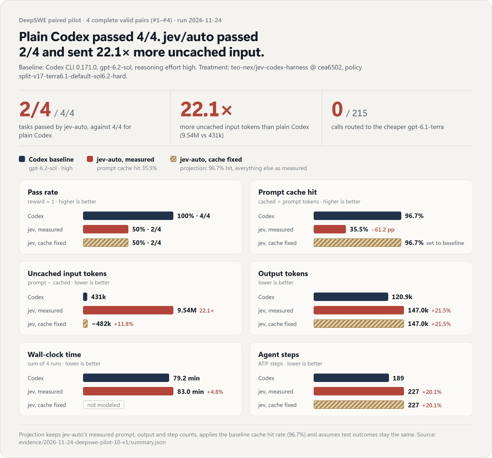
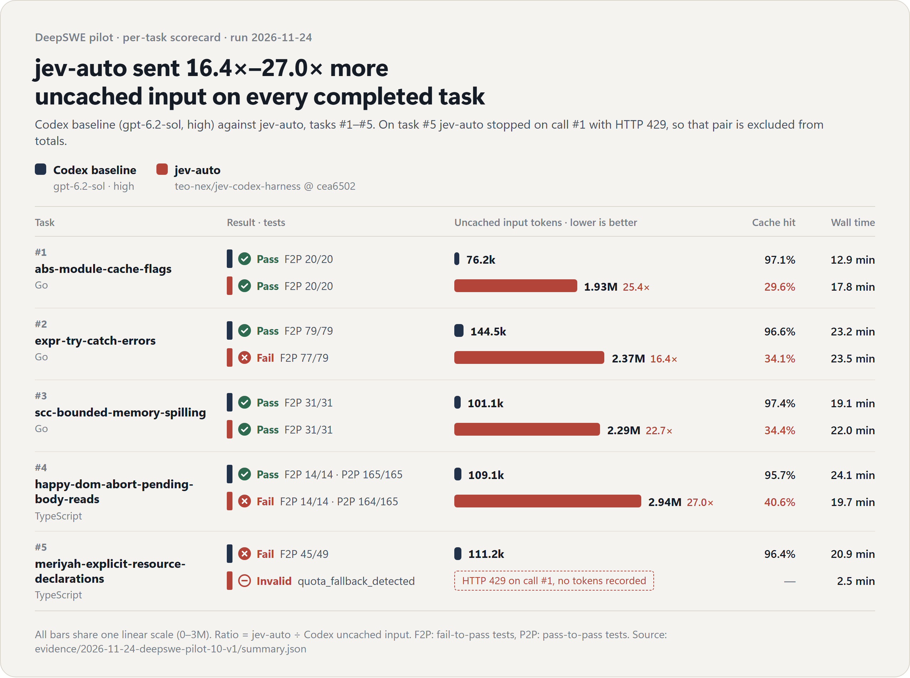
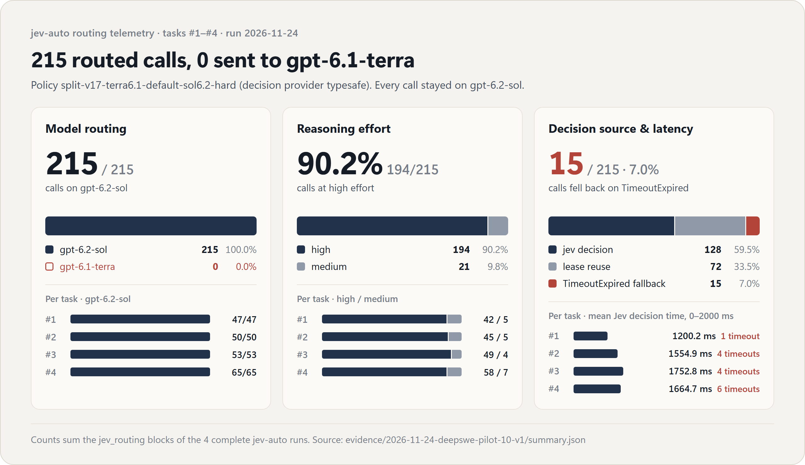

# Astra + Jev Benchmark (DeepSWE)

**English** | [Русский](README.ru.md)

[](https://github.com/datacurve-ai/deep-swe)
[](https://github.com/teo-nex/jev-codex-harness)
[](#apples-to-apples-summary-4-complete-valid-pairs-14)
[](#why-jev-auto-failed-here)
[](evidence/2026-11-24-deepswe-pilot-10-v1/)

A paired test of plain Codex CLI (`openai/gpt-6.2-sol`, `reasoning_effort=high`) against [`teo-nex/jev-codex-harness`](https://github.com/teo-nex/jev-codex-harness) (`jev/auto`), built by **Teo | Nexcore ([@teo-nex](https://github.com/teo-nex))**. Both arms ran the same real repository tasks from the open-source [DeepSWE](https://github.com/datacurve-ai/deep-swe) corpus (Apache-2.0) through `datacurve-pier==0.3.1`, inside isolated `no-network` Docker containers.

> [!IMPORTANT]
> **Verdict.** On 4 complete paired tasks, plain Codex passed **4/4**. `jev/auto` (commit `cea6502`, policy `split-v17-terra6.1-default-sol6.2-hard`) passed **2/4**, sent **22.1× more uncached input tokens** (`9.54M` vs `431k`) and routed **0 of 215** calls to the cheaper `gpt-6.1-terra`. The extra uncached input coincided with the ChatGPT subscription limit (`HTTP 429`) on the first call of task #5, which ended the 10-task pilot early.

<p align="center">
  
</p>

## What the run shows

- **Lower pass rate.** `jev-auto` passed `2/4` (`50%`); plain Codex passed `4/4` (`100%`) on the same 4 completed pairs.
- **Prompt cache collapse.** `jev-auto` hit the prompt cache on `35.5%` of input tokens against `96.7%` for plain Codex. Uncached input rose from `430,976` to `9,539,458` tokens (`22.1×`); per task the ratio ranged from `16.4×` to `27.0×`.
- **No down-routing.** The policy name promises a `gpt-6.1-terra` default, yet all `215/215` calls stayed on `gpt-6.2-sol`. `194` calls (`90.2%`) ran at `high` effort and `21` (`9.8%`) at `medium`.
- **A cache fix alone would not produce savings.** `jev-auto` took more steps (`227` vs `189`), read more prompt tokens (`+11.8%`) and wrote more output tokens (`+21.5%`). With the cache hit rate raised to baseline's `96.7%`, uncached input would still land near `482k`, `11.8%` above baseline, and `7.0%` of calls would still wait out a router timeout.
- **Reasoning tokens were the one metric that went down** (`50,275` vs `56,085`, `−10.4%`), and that drop did not offset the rest.

On hard multi-file repository tasks of DeepSWE difficulty, plain `gpt-6.2-sol (high)` in Codex CLI beat `jev/auto` on pass rate, uncached input, output tokens, steps and total wall time.

## Tested stack

| Component | Exact version / reference |
|---|---|
| Harness under test | [`teo-nex/jev-codex-harness`](https://github.com/teo-nex/jev-codex-harness) by **Teo \| Nexcore** ([@teo-nex](https://github.com/teo-nex)), commit `cea6502c8c968cef34602be4a7247ebda5d5e84c` |
| Jev routing policy | `split-v17-terra6.1-default-sol6.2-hard` (`decision_provider = typesafe`) |
| Baseline (`codex-baseline`) | Plain `codex-cli 0.171.0`, `openai/gpt-6.2-sol`, `reasoning_effort=high` |
| Treatment (`jev-auto`) | `codex-cli 0.171.0` through `jev-codex-harness` (`jev/auto`) |
| Corpus | [`datacurve-ai/deep-swe`](https://github.com/datacurve-ai/deep-swe), [`tasks/deepswe-pilot-10.json`](tasks/deepswe-pilot-10.json): stratified 10-task pilot (3 Go, 3 TypeScript, 3 Python, 1 Rust) |
| Execution | `datacurve-pier==0.3.1` (`harbor==0.27.0`), Docker Engine, `network_mode = "no-network"` with a Squid allowlist egress proxy |
| Run | 2026-11-24, `deepswe-pilot-10-v1` |

Both arms used the same ChatGPT subscription auth profile, the same pinned offline Linux x64 `codex-cli 0.171.0` binary (with `codex-code-mode-host` and `ripgrep 15.2.0`), and identical per-task Docker images and verifiers.

## Apples-to-apples summary (4 complete valid pairs, #1–#4)

The right column is a projection. It keeps `jev-auto`'s measured prompt tokens, output tokens, steps and test outcomes, and applies the baseline cache hit rate (`96.7%`) to its prompt tokens. Wall time is left unmodeled because the run gives no clean way to split prefill time from router latency.

| Metric (sum over #1–#4) | `codex-baseline` (`sol high`) | `jev-auto` measured (cache 35.5%) | `jev-auto` with cache at 96.7% (projection) |
|---|---:|---:|---:|
| Valid pairs | 4 | 4 | 4 |
| Pass (`reward=1`) | **4 / 4 (100%)** | 2 / 4 (50%) | 2 / 4 (50%) |
| Mean partial score | `1.0000` | `0.9986` | `0.9986` |
| Wall-clock time | **79.2 min** (`4753.92 s`) | 83.0 min (`4981.62 s`, `+4.8%`) | not modeled |
| Agent steps (ATIF) | **189** | 227 (`+20.1%`) | 227 (`+20.1%`) |
| Total prompt tokens | **13,236,480** | 14,795,778 (`+11.8%`) | 14,795,778 (`+11.8%`) |
| Cached prompt tokens | 12,805,504 (**96.7%**) | 5,256,320 (**35.5%**) | ~14,314,000 (96.7%) |
| **Uncached input tokens** | **430,976** | **9,539,458 (`22.1×`)** | ~482,000 (`+11.8%`) |
| **Output tokens** | **120,923** | 146,980 (`+21.5%`) | 146,980 (`+21.5%`) |
| Reasoning tokens | 56,085 | 50,275 (`−10.4%`) | 50,275 (`−10.4%`) |
| Calls to `gpt-6.1-terra` | n/a | **0 / 215 (0%)** | **0 / 215 (0%)** |
| Effort split (`high` / `medium`) | 100% / 0% | 90.2% / 9.8% (`194` / `21`) | 90.2% / 9.8% |
| Jev decision sources | n/a | `jev: 128`, `lease: 72`, `technical_fallback: 15` (`7.0%`) | same |

## Per-task results (`deepswe-pilot-10-v1`)

<p align="center">
  
</p>

| # | Task | Lang | Mode | Valid | Reward | F2P | P2P | Time (s) | Prompt / Cache % | Uncached In | Output / Reas | Jev telemetry |
|---:|---|---|---|---:|---:|---|---|---:|---|---:|---|---|
| 1 | `abs-module-cache-flags` | go | `codex-baseline` | yes | **1** | 20/20 | 3/3 | 771.24 | 2.66M / 97.1% | 76.2k | 27.5k / 13.6k | n/a |
| 1 | `abs-module-cache-flags` | go | `jev-auto` | yes | **1** | 20/20 | 3/3 | 1070.03 | 2.75M / 29.6% | 1.93M | 36.7k / 11.5k | `sol:47`, `high:42/med:5`, `lease:18`, `timeout:1`, `avg 1200ms` |
| 2 | `expr-try-catch-errors` | go | `codex-baseline` | yes | **1** | 79/79 | 66265/66265 | 1391.23 | 4.23M / 96.6% | 144.5k | 36.4k / 18.3k | n/a |
| 2 | `expr-try-catch-errors` | go | `jev-auto` | yes | **0** | 77/79 | 66265/66265 | 1407.12 | 3.59M / 34.1% | 2.37M | 38.0k / 13.8k | `sol:50`, `high:45/med:5`, `lease:11`, `timeout:4`, `avg 1555ms` |
| 3 | `scc-bounded-memory-spilling` | go | `codex-baseline` | yes | **1** | 31/31 | 286/286 | 1144.94 | 3.82M / 97.4% | 101.1k | 35.6k / 14.7k | n/a |
| 3 | `scc-bounded-memory-spilling` | go | `jev-auto` | yes | **1** | 31/31 | 286/286 | 1322.10 | 3.50M / 34.4% | 2.29M | 41.0k / 14.7k | `sol:53`, `high:49/med:4`, `lease:27`, `timeout:4`, `avg 1753ms` |
| 4 | `happy-dom-abort-pending-body-reads` | ts | `codex-baseline` | yes | **1** | 14/14 | 165/165 | 1446.51 | 2.53M / 95.7% | 109.1k | 21.4k / 9.5k | n/a |
| 4 | `happy-dom-abort-pending-body-reads` | ts | `jev-auto` | yes | **0** | 14/14 | **164/165** | 1182.37 | 4.95M / 40.6% | 2.94M | 31.3k / 10.3k | `sol:65`, `high:58/med:7`, `lease:16`, `timeout:6`, `avg 1665ms` |
| 5 | `meriyah-explicit-resource-declarations` | ts | `codex-baseline` | yes | **0** | 45/49 | 51469/51469 | 1251.19 | 3.08M / 96.4% | 111.2k | 16.1k / 6.4k | n/a |
| 5 | `meriyah-explicit-resource-declarations` | ts | `jev-auto` | no | 0 | 0/49 | n/a | 150.03 | 0 / n/a | 0 | 0 / 0 | `HTTP 429` usage limit on call #1 (`quota_fallback_detected`) |
| 6–10 | `arktype`, `mashumaro`, `fastapi`, `vulture`, `oxvg` | ts/py/rs | both | pending | n/a | n/a | n/a | n/a | n/a | n/a | n/a | Pilot stopped cleanly at the quota limit |

## Why `jev-auto` failed here

<p align="center">
  
</p>

1. **Prompt cache collapse (`35.5%` vs `96.7%`).**
   Across tasks #1–#4, `jev-auto` sent `9.54M` uncached input tokens where the baseline sent `431k`. The run did not isolate the cause. Candidates in the `codex-cli` → `jev-codex-harness` path: `reasoning_effort` switching between `high` and `medium` mid-session, request rewriting in the `router.mjs` proxy, and `codex-cli 0.171.0` logging `Model metadata for jev/auto not found. Defaulting to fallback metadata`.
2. **Zero down-routing to `gpt-6.1-terra` (`0 / 215`).**
   Under `split-v17-terra6.1-default-sol6.2-hard`, the router never sent a call to the cheaper model. Dropping effort to `medium` on `9.8%` of calls did not cut total usage: the treatment arm ran `20.1%` more steps and emitted `21.5%` more output tokens.
3. **Router latency and timeouts (`15 / 215` = `7.0%`).**
   Mean Jev decision time per task ranged from `1200.2 ms` to `1752.8 ms`. Fifteen calls fell back through `technical_fallback` after `jev_error:TimeoutExpired`.

## Scope and limits

- **Small sample.** `N = 4` complete valid pairs, plus one valid baseline run on task #5. The subscription quota ran out on task #5; the 22.1× uncached-input volume is the most likely reason it ran out that early.
- **Close test margins.** Both failed `jev-auto` tasks came close to passing (`77/79` F2P on #2; `14/14` F2P with one `164/165` P2P regression on #4). Treat the `50%` vs `100%` pass-rate gap as a 4-task observation with wide variance.
- **The cost result rests on telemetry from all 215 calls**: `0/215` on `gpt-6.1-terra`, `90.2%` at `high`, output tokens `+21.5%`, cache hit rate down `61.2` percentage points.
- **One workload, one commit.** Results cover hard multi-file SWE tasks under `jev-codex-harness` commit `cea6502` with policy `split-v17-terra6.1-default-sol6.2-hard`. A mixed workload of many trivial prompts routed whole-task to a cheaper model, with a working prompt cache, was not tested.
- **The projection column is arithmetic, not a run.** It assumes the same test outcomes, steps and output volume after a cache fix.

## Evidence and verification

Redacted run artifacts live in [`evidence/2026-11-24-deepswe-pilot-10-v1/`](evidence/2026-11-24-deepswe-pilot-10-v1/):

- [`summary.json`](evidence/2026-11-24-deepswe-pilot-10-v1/summary.json): per-task rewards, ATIF token totals and Jev routing counters. Local filesystem mount prefixes are stripped; it contains no credentials, prompts or raw model output.
- [`summary.md`](evidence/2026-11-24-deepswe-pilot-10-v1/summary.md): rendered per-task and aggregate tables.
- [`manifest.json`](evidence/2026-11-24-deepswe-pilot-10-v1/manifest.json): environment versions and SHA-256 digests of `summary.json` and `summary.md`.

Check the digests and run the unit tests (no API spend):

```bash
sha256sum evidence/2026-11-24-deepswe-pilot-10-v1/summary.json evidence/2026-11-24-deepswe-pilot-10-v1/summary.md
python -m unittest discover -s tests -v
```

Every number in the charts is computed from `summary.json` by [`scripts/render_charts.py`](scripts/render_charts.py). To print the computed metrics or rebuild the PNGs:

```bash
python scripts/render_charts.py --print-metrics   # numbers only, no browser needed
pip install playwright && python -m playwright install chromium
python scripts/render_charts.py                   # writes docs/images/{en,ru}/*.png
```

## Repository layout

```text
jev_astra_bench/          DeepSWE Pier adapter, TCP bridge, paired runner and report builder
scripts/                  PowerShell/WSL2 wrappers and a zero-cost mock Responses API check
scripts/render_charts.py  Chart renderer: summary.json -> HTML/SVG -> 2x PNG via Playwright
docs/images/en/, ru/      Rendered charts used in README.md and README.ru.md
tasks/                    deepswe-pilot-10.json, the stratified 10-task manifest
tests/                    Unit tests for the manifest, Squid proxy compose, bridge and reporting
evidence/                 Redacted 2026-11-24 pilot summary and SHA-256 manifest
```

## Credits

`jev-codex-harness` and the Jev router are the work of **Teo | Nexcore ([@teo-nex](https://github.com/teo-nex))**. This benchmark tests one commit (`cea6502`) and one policy on one workload, and the per-task evidence is published so the result can be checked and rerun against later versions. DeepSWE tasks come from [`datacurve-ai/deep-swe`](https://github.com/datacurve-ai/deep-swe) (Apache-2.0).
