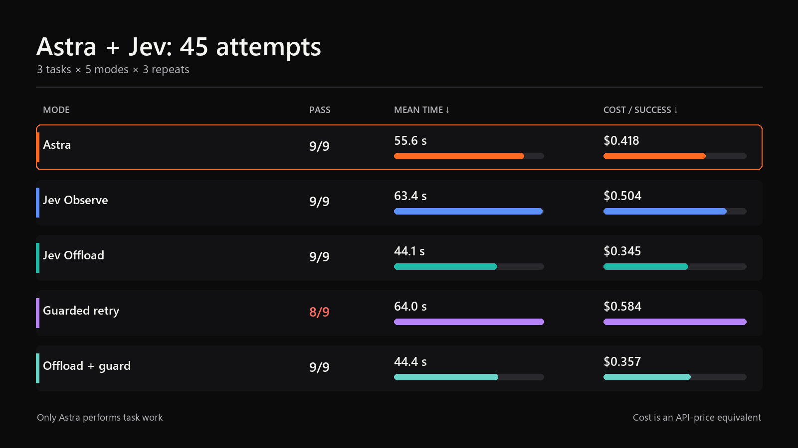
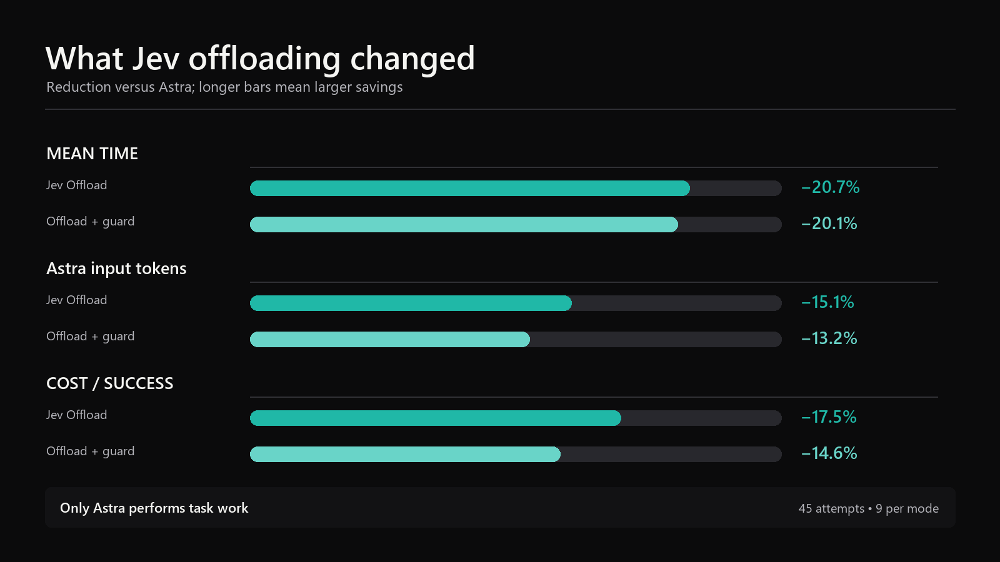
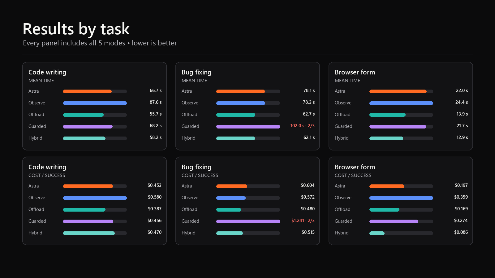

# Astra + Jev Benchmark

**English** | [Русский](README.ru.md)

A reproducible comparison of Astra alone and Astra assisted by Jev on code writing, bug fixing, and a local browser-form task.

A separate [React website pilot](REACT-PILOT.md) completed 20 attempts with `gpt-6-astra` and `gpt-6.1-sol`, baseline and Jev offload, five runs per combination. The [original results](docs/REACT-PILOT-RESULTS-2026-10-23.md) and [three owner-requested reruns](docs/REACT-PILOT-RERUN-RESULTS-2026-10-23.md) are reported separately. After the reruns, successful attempts were 4/5, 4/5, 4/5 and 5/5 respectively; two timeouts and one mobile-overflow failure remain. Functional checks do not rate visual quality. The published September results below remain unchanged.

[Machine-readable React results and rerun provenance](evidence/2026-10-23-react-pilot/README.md).

The published September benchmark isolates one working model: `gpt-6-astra` at `xhigh` reasoning. User plugins, hooks, apps, memory, and parallel agents are disabled. Jev does not route work to Luna, Terra, Sol, or another language model. It selects bounded decisions from task-specific allow lists; Astra still performs the work.

## Result

The published run contains 45 attempts: three tasks, five modes, and three repeats for every task-mode pair.

| Mode | Passed | Mean time | Total cost | Cost per success |
|---|---:|---:|---:|---:|
| Astra | 9/9 | 55.6 s | $3.764 | $0.418 |
| Jev Observe | 9/9 | 63.4 s | $4.534 | $0.504 |
| Jev Offload | 9/9 | 44.1 s | $3.107 | $0.345 |
| Guarded retry | 8/9 | 64.0 s | $4.672 | $0.584 |
| Offload + guard | 9/9 | 44.4 s | $3.214 | $0.357 |



Jev Offload produced the best aggregate result on this task set. Compared with Astra alone, it reduced:

- mean duration by 20.7%;
- Astra input tokens by 15.1%;
- cost per successful task by 17.5%.

Success stayed at 9/9. Offload + guard kept a 9/9 success rate while reducing mean duration by 20.1% and cost per success by 14.6%.



Observe increased cost per success by 20.5%. Guarded retry increased it by 39.6% and passed 8 of 9 attempts. Jev reduced cost only when it selected a bounded strategy before Astra started.

## Modes

| Mode | Before Astra | After Astra | Extra Astra pass |
|---|---|---|---:|
| `astra_only` | No Jev call | Required local verification | No |
| `astra_jev_observe` | No Jev call | Jev records a verdict without changing the outcome | No |
| `astra_jev_offload` | Jev selects an allowed strategy or browser action | Required local verification | No |
| `astra_jev_guarded` | Astra chooses the approach | A failed verifier or Jev verdict can request a correction | One |
| `astra_jev_offload_guarded` | Jev selects a strategy before each pass | Local verification checks facts, then Jev accepts or requests a correction | One |

Each task defines the choices Jev may return. Jev cannot select an arbitrary shell command or introduce a new tool.

## Tasks

1. **Code writing:** implement `slugify` from a fixed specification and pass the tests.
2. **Bug fixing:** repair `clamp.py` without changing the protected test file.
3. **Browser form:** extract a value, fill a local page, and verify its `submitted` state.

Every attempt receives a fresh fixture. Modes cannot reuse another mode's output. The runner rotates mode order between repeats so that one mode does not keep the same cache-warming position.



## The failed attempt

On the third bug-fix repeat, `astra_jev_guarded` changed both the allowed `clamp.py` and the protected `test_clamp.py`. Local verification rejected the first pass before Jev was called. Astra received `retry_scope`, then changed the protected test again. The attempt stopped after the two-pass limit.

That attempt took 170 seconds and cost $1.161. The scope verifier recorded the failure; the retry did not bring Astra back inside the task boundary.

## Cost calculation

The estimate includes:

- uncached Astra input tokens;
- cached and cache-write Astra input tokens;
- Astra output tokens;
- Jev input tokens;
- every Astra retry and Jev call.

```text
total cost = Astra cost + Jev cost
cost per success = cost of all attempts / successful tasks
```

The calculation uses Astra Standard short-context prices and the public Jev price checked on September 21, 2026. These values are API-price equivalents; Codex subscription usage may be charged differently.

See the [full English report](RESULTS.md), the [Russian report](RESULTS.ru.md), and the published [`evidence/2026-09-21-five-mode/`](evidence/2026-09-21-five-mode/) directory.

## Verify the evidence

1. Compare the summary with [`combined-report.json`](evidence/2026-09-21-five-mode/combined-report.json).
2. Inspect all 45 attempts in [`attempts.jsonl`](evidence/2026-09-21-five-mode/full-five-mode/attempts.jsonl).
3. Verify file SHA-256 values against [`manifest.json`](evidence/2026-09-21-five-mode/manifest.json).
4. Run the unit tests and canary below.

Published evidence is redacted. It contains no API keys, local paths, model responses, or raw tool output.

## Requirements

- Python 3.11 or newer;
- an installed and authenticated Codex CLI;
- access to `gpt-6-astra`;
- a TypeSafe key in `TYPESAFE_API_KEY` for Jev modes;
- PowerShell 7 for the `.ps1` scripts;
- Playwright and Chromium for the live browser task.

Copy `benchmark-config.example.toml` to `benchmark-config.toml`, then confirm current prices before publishing a new run. Git ignores `benchmark-config.toml`.

Set the key only for the current terminal session:

```powershell
$env:TYPESAFE_API_KEY = "test key"
```

## Local checks without API spend

```powershell
python -m unittest discover -s tests -v
pwsh -NoProfile -File .\scripts\run-benchmark.ps1 -Mode canary
```

The canary uses fake Astra and Jev responses to create 15 records: three tasks in five modes. It checks fixture copying, mandatory verification, retry handling, and report generation. It does not measure savings.

## Live-run preflight

```powershell
python .\run_benchmark.py preflight `
  --mode astra_only `
  --mode astra_jev_observe `
  --mode astra_jev_offload `
  --mode astra_jev_guarded `
  --mode astra_jev_offload_guarded
```

Preflight checks Python, Codex, task fixtures, Playwright, and the Jev key without printing the key value.

## Full live run

```powershell
pwsh -NoProfile -File .\scripts\run-benchmark.ps1 `
  -Mode full `
  -Config .\benchmark-config.toml
```

The runner writes `attempts.jsonl` and `report.json` under the ignored `results/` directory.

If Codex exits before returning a model response, the benchmark stops with exit code `3`. After service recovery, resume the same matrix:

```powershell
python .\run_benchmark.py run `
  --mode astra_only `
  --mode astra_jev_observe `
  --mode astra_jev_offload `
  --mode astra_jev_guarded `
  --mode astra_jev_offload_guarded `
  --repeats 3 `
  --config .\benchmark-config.toml `
  --output .\results\interrupted-run-name `
  --resume
```

`--resume` reruns only missing task-mode pairs and infrastructure failures. Completed attempts and ordinary verifier failures remain unchanged.

## Limits

- Each task-mode pair has three repeats.
- The tasks are synthetic and shorter than real development work.
- The browser task uses a local page without network access or credentials.
- The first full run crossed a temporary Astra outage. The runner resumed only missing pairs after recovery; the published set contains 45 unique attempts and no infrastructure failures.
- Results apply to the listed model, prices, tasks, and run date. Other workloads require a separate measurement.

## Repository layout

```text
jev_astra_bench/   runner and metric calculation
tasks/             three source fixtures
tests/             unit tests and canary
scripts/           run, compare, and evidence-export scripts
evidence/          redacted published run
docs/images/en/    English charts
docs/images/ru/    Russian charts
RESULTS.md         full English report
RESULTS.ru.md      full Russian report
```
