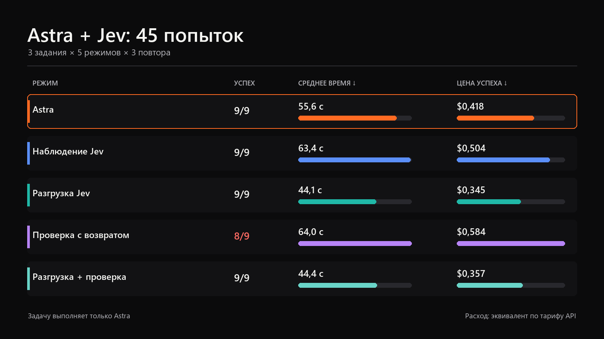
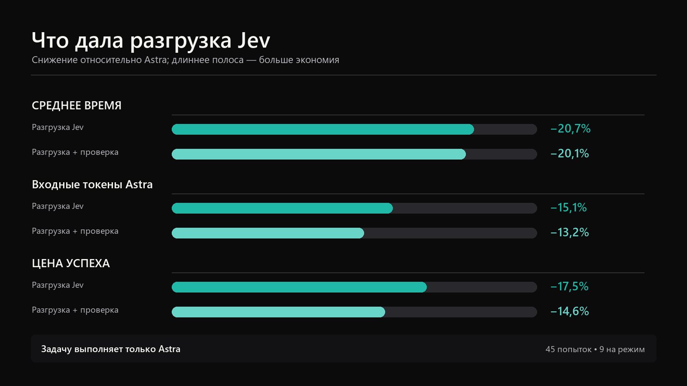
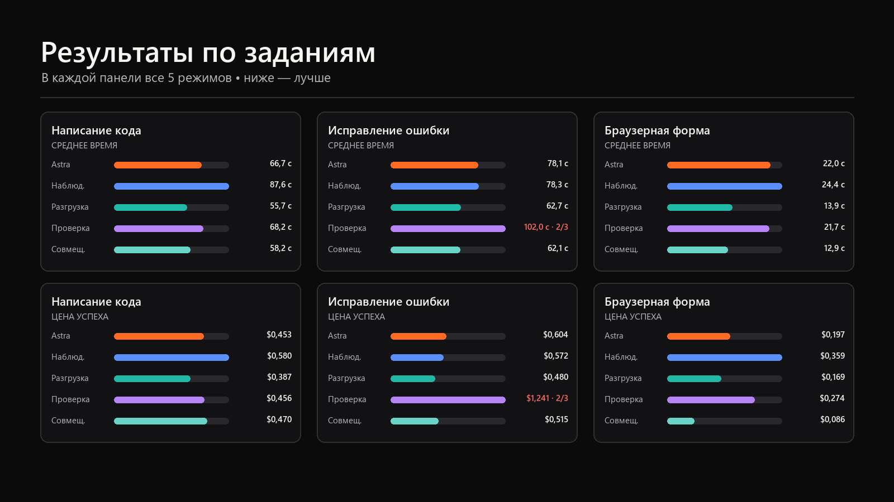

# Бенчмарк Astra + Jev

[English](README.md) | **Русский**

Воспроизводимое сравнение Astra и Astra с Jev на задачах написания кода, исправления ошибки и работы с локальной браузерной формой.

В замере работает одна модель: `gpt-6-astra` с уровнем рассуждения `xhigh`. Пользовательские дополнения, перехватчики, приложения, память и параллельные агенты отключены. Jev не передаёт работу Luna, Terra, Sol или другой языковой модели. Он выбирает ограниченные решения из заданных для каждого задания списков; саму работу выполняет Astra.

## Результат

Опубликованный прогон содержит 45 попыток: три задания, пять режимов и три повтора каждого сочетания задания и режима.

| Режим | Успешно | Среднее время | Общий расход | Цена успешной задачи |
|---|---:|---:|---:|---:|
| Astra | 9/9 | 55,6 с | $3,764 | $0,418 |
| Наблюдение Jev | 9/9 | 63,4 с | $4,534 | $0,504 |
| Разгрузка Jev | 9/9 | 44,1 с | $3,107 | $0,345 |
| Проверка с возвратом | 8/9 | 64,0 с | $4,672 | $0,584 |
| Разгрузка + проверка | 9/9 | 44,4 с | $3,214 | $0,357 |



На этом наборе лучший общий результат показала разгрузка Jev. По сравнению с Astra она сократила:

- среднее время на 20,7%;
- входные токены Astra на 15,1%;
- цену успешной задачи на 17,5%.

Успешность сохранилась на уровне 9/9. Совмещённый режим также получил 9/9, сократив среднее время на 20,1%, а цену успешной задачи — на 14,6%.



Наблюдение увеличило цену успешной задачи на 20,5%. Проверка с возвратом увеличила её на 39,6% и прошла 8 попыток из 9. Расход снизился только в режимах, где Jev выбирал ограниченную стратегию до запуска Astra.

## Режимы

| Режим | До Astra | После Astra | Повтор Astra |
|---|---|---|---:|
| `astra_only` | Jev не вызывается | Обязательная локальная проверка | Нет |
| `astra_jev_observe` | Jev не вызывается | Jev записывает вердикт, не меняя результат | Нет |
| `astra_jev_offload` | Jev выбирает разрешённую стратегию или браузерное действие | Обязательная локальная проверка | Нет |
| `astra_jev_guarded` | Astra выбирает способ решения | Провал проверки или вердикт Jev может запросить исправление | Один |
| `astra_jev_offload_guarded` | Jev выбирает стратегию перед каждым проходом | Локальная проверка отсеивает фактический провал, затем Jev принимает результат или запрашивает исправление | Один |

Разрешённые ответы Jev задаются каждым заданием. Jev не может выбрать произвольную команду оболочки или подключить новый инструмент.

## Задания

1. **Написание кода:** реализовать `slugify` по заданным требованиям и пройти тесты.
2. **Исправление ошибки:** исправить `clamp.py`, не меняя защищённый тестовый файл.
3. **Браузерная форма:** извлечь значение, заполнить локальную страницу и подтвердить состояние `submitted`.

Каждая попытка получает новую копию исходных файлов. Режимы не используют результаты друг друга. Порядок режимов сдвигается между повторами, чтобы один режим не занимал постоянную позицию относительно прогрева кэша.



## Неуспешная попытка

В третьем повторе исправления ошибки режим `astra_jev_guarded` изменил разрешённый `clamp.py` и защищённый `test_clamp.py`. Локальная проверка отклонила первый проход до обращения к Jev. Astra получила причину `retry_scope`, затем снова изменила защищённый тест. Попытка остановилась после установленного предела в два прохода.

Этот запуск занял 170 секунд и стоил $1,161. Проверка области изменений зафиксировала нарушение; повторный проход не вернул Astra в границы задания.

## Расчёт расхода

В оценку входят:

- обычные входные токены Astra;
- кэшированные и записанные в кэш входные токены Astra;
- выходные токены Astra;
- входные токены Jev;
- все повторные проходы Astra и обращения Jev.

```text
общий расход = расход Astra + расход Jev
цена успешной задачи = расход всех попыток / число успешных задач
```

Расчёт использует цены Astra Standard для короткого контекста и публичную цену Jev, проверенные 21 сентября 2026 года. Это эквивалент по тарифам API; лимиты подписки Codex могут списываться иначе.

Смотрите [полный русский отчёт](RESULTS.ru.md), [английский отчёт](RESULTS.md) и опубликованный каталог [`evidence/2026-09-21-five-mode/`](evidence/2026-09-21-five-mode/).

## Проверка доказательств

1. Сверьте сводку с [`combined-report.json`](evidence/2026-09-21-five-mode/combined-report.json).
2. Проверьте все 45 попыток в [`attempts.jsonl`](evidence/2026-09-21-five-mode/full-five-mode/attempts.jsonl).
3. Сверьте SHA-256 файлов по [`manifest.json`](evidence/2026-09-21-five-mode/manifest.json).
4. Запустите модульные тесты и канарейку по командам ниже.

Опубликованные доказательства обезличены. Они не содержат ключей, локальных путей, ответов моделей и необработанного вывода инструментов.

## Требования

- Python 3.11 или новее;
- установленный и авторизованный Codex CLI;
- доступ к `gpt-6-astra`;
- ключ TypeSafe в `TYPESAFE_API_KEY` для режимов с Jev;
- PowerShell 7 для сценариев `.ps1`;
- Playwright и Chromium для живой браузерной задачи.

Скопируйте `benchmark-config.example.toml` в `benchmark-config.toml`, затем проверьте актуальные цены перед публикацией нового прогона. Git игнорирует `benchmark-config.toml`.

Задайте ключ только для текущего терминала:

```powershell
$env:TYPESAFE_API_KEY = "тестовый ключ"
```

## Локальная проверка без расхода API

```powershell
python -m unittest discover -s tests -v
pwsh -NoProfile -File .\scripts\run-benchmark.ps1 -Mode canary
```

Канарейка использует поддельные ответы Astra и Jev и создаёт 15 записей: три задания в пяти режимах. Она проверяет копирование заданий, обязательные проверки, повторные проходы и построение отчёта. Канарейка не измеряет экономию.

## Предварительная проверка живого запуска

```powershell
python .\run_benchmark.py preflight `
  --mode astra_only `
  --mode astra_jev_observe `
  --mode astra_jev_offload `
  --mode astra_jev_guarded `
  --mode astra_jev_offload_guarded
```

Команда проверяет Python, Codex, задания, Playwright и наличие ключа, не выводя его значение.

## Полный живой запуск

```powershell
pwsh -NoProfile -File .\scripts\run-benchmark.ps1 `
  -Mode full `
  -Config .\benchmark-config.toml
```

Стенд сохраняет `attempts.jsonl` и `report.json` в исключённом из Git каталоге `results/`.

Если Codex завершился до ответа модели, стенд останавливается с кодом `3`. После восстановления сервиса продолжите ту же матрицу:

```powershell
python .\run_benchmark.py run `
  --mode astra_only `
  --mode astra_jev_observe `
  --mode astra_jev_offload `
  --mode astra_jev_guarded `
  --mode astra_jev_offload_guarded `
  --repeats 3 `
  --config .\benchmark-config.toml `
  --output .\results\имя-прерванного-прогона `
  --resume
```

`--resume` повторяет только отсутствующие сочетания и инфраструктурные отказы. Завершённые попытки и обычные провалы проверки сохраняются.

## Ограничения

- На каждое сочетание задания и режима приходится три повтора.
- Задания синтетические и короче реальной разработки.
- Браузерная задача использует локальную страницу без сети и учётных данных.
- Первый полный запуск попал во временное окно недоступности Astra. После восстановления стенд продолжил только отсутствующие сочетания; опубликованный набор содержит 45 уникальных попыток без инфраструктурных отказов.
- Результаты относятся к указанной модели, ценам, заданиям и дате запуска. Для другой нагрузки нужен отдельный замер.

## Структура репозитория

```text
jev_astra_bench/   исполнитель и расчёт метрик
tasks/             три исходных задания
tests/             модульные тесты и канарейка
scripts/           запуск, сравнение и экспорт доказательств
evidence/          обезличенный опубликованный прогон
docs/images/en/    английские графики
docs/images/ru/    русские графики
RESULTS.md         полный английский отчёт
RESULTS.ru.md      полный русский отчёт
```
