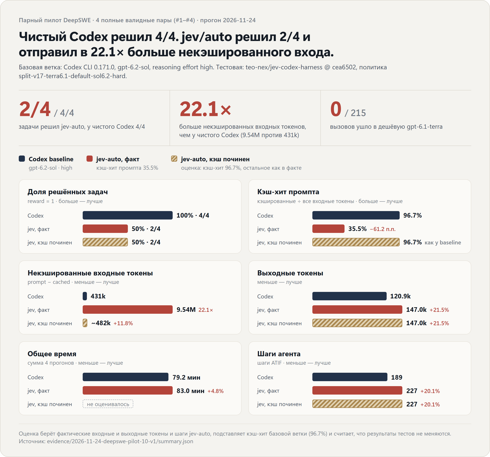
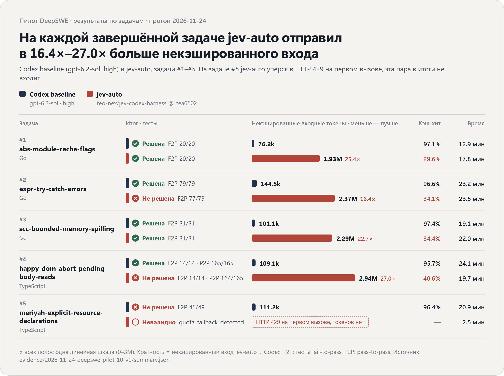
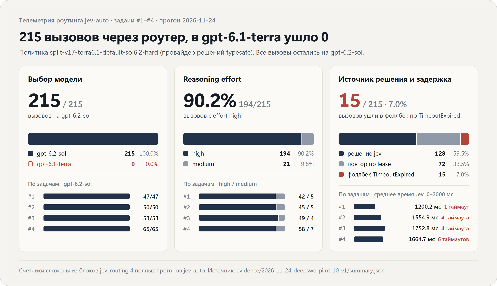

# Бенчмарк Astra + Jev (DeepSWE)

[English](README.md) | **Русский**

[](https://github.com/datacurve-ai/deep-swe)
[](https://github.com/teo-nex/jev-codex-harness)
[](#сводка-по-4-полным-валидным-парам-14)
[](#почему-jev-auto-провалился)
[](evidence/2026-11-24-deepswe-pilot-10-v1/)

Парное сравнение чистого Codex CLI (`openai/gpt-6.2-sol`, `reasoning_effort=high`) и [`teo-nex/jev-codex-harness`](https://github.com/teo-nex/jev-codex-harness) (`jev/auto`). Автор харнесса — **Teo | Nexcore ([@teo-nex](https://github.com/teo-nex))**. Обе ветки решали одни и те же реальные задачи из открытого корпуса [DeepSWE](https://github.com/datacurve-ai/deep-swe) (Apache-2.0) через `datacurve-pier==0.3.1` в изолированных Docker-контейнерах без сети (`no-network`).

> [!IMPORTANT]
> **Итог.** На 4 полных парах задач чистый Codex решил **4 из 4**. `jev/auto` (коммит `cea6502`, политика `split-v17-terra6.1-default-sol6.2-hard`) решил **2 из 4**, отправил в **22.1 раза больше некэшированных входных токенов** (`9.54M` против `431k`) и **ни один из 215 вызовов** не направил в дешёвую `gpt-6.1-terra`. На первом же вызове задачи #5 подписка ChatGPT упёрлась в лимит (`HTTP 429`), и пилот из 10 задач остановился раньше срока.

<p align="center">
  
</p>

## Что показал прогон

- **Меньше решённых задач.** `jev-auto` решил `2/4` (`50%`), чистый Codex — `4/4` (`100%`) на тех же 4 завершённых парах.
- **Обвал prompt cache.** У `jev-auto` из кэша пришло `35.5%` входных токенов, у чистого Codex — `96.7%`. Некэшированный вход вырос с `430,976` до `9,539,458` токенов (`22.1×`), по отдельным задачам — от `16.4×` до `27.0×`.
- **Даун-роутинга не было.** По названию политики дешёвая `gpt-6.1-terra` должна работать по умолчанию, но все `215/215` вызовов остались на `gpt-6.2-sol`. С effort `high` прошло `194` вызова (`90.2%`), с `medium` — `21` (`9.8%`).
- **Починка кэша сама по себе экономии не даст.** `jev-auto` сделал больше шагов (`227` против `189`), прочитал больше входных токенов (`+11.8%`) и написал больше выходных (`+21.5%`). Если поднять кэш-хит до эталонных `96.7%`, некэшированный вход останется около `482k`, на `11.8%` выше базового, а `7.0%` вызовов по-прежнему будут ждать таймаута роутера.
- **Снизились только reasoning-токены** (`50,275` против `56,085`, `−10.4%`), и остальной перерасход это не покрыло.

На сложных многофайловых задачах уровня DeepSWE чистый `gpt-6.2-sol (high)` в Codex CLI обошёл `jev/auto` по доле решённых задач, некэшированному входу, выходным токенам, числу шагов и общему времени.

## Проверенный стек

| Компонент | Точная версия / ссылка |
|---|---|
| Тестируемый харнесс | [`teo-nex/jev-codex-harness`](https://github.com/teo-nex/jev-codex-harness), автор **Teo \| Nexcore** ([@teo-nex](https://github.com/teo-nex)), коммит `cea6502c8c968cef34602be4a7247ebda5d5e84c` |
| Политика роутинга Jev | `split-v17-terra6.1-default-sol6.2-hard` (`decision_provider = typesafe`) |
| Базовая ветка (`codex-baseline`) | Чистый `codex-cli 0.171.0`, `openai/gpt-6.2-sol`, `reasoning_effort=high` |
| Тестовая ветка (`jev-auto`) | `codex-cli 0.171.0` через `jev-codex-harness` (`jev/auto`) |
| Корпус задач | [`datacurve-ai/deep-swe`](https://github.com/datacurve-ai/deep-swe), [`tasks/deepswe-pilot-10.json`](tasks/deepswe-pilot-10.json): 10 задач с разбивкой по языкам (3 Go, 3 TypeScript, 3 Python, 1 Rust) |
| Среда запуска | `datacurve-pier==0.3.1` (`harbor==0.27.0`), Docker Engine, `network_mode = "no-network"` и Squid-прокси с allowlist |
| Прогон | 2026-11-24, `deepswe-pilot-10-v1` |

Обе ветки использовали один профиль подписки ChatGPT, один зафиксированный офлайн-бинарник Linux x64 `codex-cli 0.171.0` (с `codex-code-mode-host` и `ripgrep 15.2.0`) и одинаковые Docker-образы и верификаторы задач.

## Сводка по 4 полным валидным парам (#1–#4)

Правый столбец — расчёт. Он берёт фактические входные и выходные токены, шаги и результаты тестов `jev-auto` и применяет к входным токенам кэш-хит базовой ветки (`96.7%`). Время в расчёт не входит: по данным прогона нельзя честно отделить время префилла от задержки роутера.

| Метрика (сумма по #1–#4) | `codex-baseline` (`sol high`) | `jev-auto`, факт (кэш 35.5%) | `jev-auto` при кэше 96.7% (расчёт) |
|---|---:|---:|---:|
| Валидных пар | 4 | 4 | 4 |
| Решено (`reward=1`) | **4 / 4 (100%)** | 2 / 4 (50%) | 2 / 4 (50%) |
| Средний partial | `1.0000` | `0.9986` | `0.9986` |
| Общее время | **79.2 мин** (`4753.92 с`) | 83.0 мин (`4981.62 с`, `+4.8%`) | не оценивалось |
| Шаги агента (ATIF) | **189** | 227 (`+20.1%`) | 227 (`+20.1%`) |
| Все входные токены | **13,236,480** | 14,795,778 (`+11.8%`) | 14,795,778 (`+11.8%`) |
| Кэшированные входные токены | 12,805,504 (**96.7%**) | 5,256,320 (**35.5%**) | ~14,314,000 (96.7%) |
| **Некэшированный вход** | **430,976** | **9,539,458 (`22.1×`)** | ~482,000 (`+11.8%`) |
| **Выходные токены** | **120,923** | 146,980 (`+21.5%`) | 146,980 (`+21.5%`) |
| Reasoning-токены | 56,085 | 50,275 (`−10.4%`) | 50,275 (`−10.4%`) |
| Вызовов `gpt-6.1-terra` | — | **0 / 215 (0%)** | **0 / 215 (0%)** |
| Effort (`high` / `medium`) | 100% / 0% | 90.2% / 9.8% (`194` / `21`) | 90.2% / 9.8% |
| Источники решений Jev | — | `jev: 128`, `lease: 72`, `technical_fallback: 15` (`7.0%`) | без изменений |

## Результаты по задачам (`deepswe-pilot-10-v1`)

<p align="center">
  
</p>

| # | Задача | Язык | Режим | Valid | Reward | F2P | P2P | Время (с) | Prompt / Cache % | Uncached In | Output / Reas | Телеметрия Jev |
|---:|---|---|---|---:|---:|---|---|---:|---|---:|---|---|
| 1 | `abs-module-cache-flags` | go | `codex-baseline` | yes | **1** | 20/20 | 3/3 | 771.24 | 2.66M / 97.1% | 76.2k | 27.5k / 13.6k | — |
| 1 | `abs-module-cache-flags` | go | `jev-auto` | yes | **1** | 20/20 | 3/3 | 1070.03 | 2.75M / 29.6% | 1.93M | 36.7k / 11.5k | `sol:47`, `high:42/med:5`, `lease:18`, `timeout:1`, `avg 1200ms` |
| 2 | `expr-try-catch-errors` | go | `codex-baseline` | yes | **1** | 79/79 | 66265/66265 | 1391.23 | 4.23M / 96.6% | 144.5k | 36.4k / 18.3k | — |
| 2 | `expr-try-catch-errors` | go | `jev-auto` | yes | **0** | 77/79 | 66265/66265 | 1407.12 | 3.59M / 34.1% | 2.37M | 38.0k / 13.8k | `sol:50`, `high:45/med:5`, `lease:11`, `timeout:4`, `avg 1555ms` |
| 3 | `scc-bounded-memory-spilling` | go | `codex-baseline` | yes | **1** | 31/31 | 286/286 | 1144.94 | 3.82M / 97.4% | 101.1k | 35.6k / 14.7k | — |
| 3 | `scc-bounded-memory-spilling` | go | `jev-auto` | yes | **1** | 31/31 | 286/286 | 1322.10 | 3.50M / 34.4% | 2.29M | 41.0k / 14.7k | `sol:53`, `high:49/med:4`, `lease:27`, `timeout:4`, `avg 1753ms` |
| 4 | `happy-dom-abort-pending-body-reads` | ts | `codex-baseline` | yes | **1** | 14/14 | 165/165 | 1446.51 | 2.53M / 95.7% | 109.1k | 21.4k / 9.5k | — |
| 4 | `happy-dom-abort-pending-body-reads` | ts | `jev-auto` | yes | **0** | 14/14 | **164/165** | 1182.37 | 4.95M / 40.6% | 2.94M | 31.3k / 10.3k | `sol:65`, `high:58/med:7`, `lease:16`, `timeout:6`, `avg 1665ms` |
| 5 | `meriyah-explicit-resource-declarations` | ts | `codex-baseline` | yes | **0** | 45/49 | 51469/51469 | 1251.19 | 3.08M / 96.4% | 111.2k | 16.1k / 6.4k | — |
| 5 | `meriyah-explicit-resource-declarations` | ts | `jev-auto` | no | 0 | 0/49 | — | 150.03 | 0 / — | 0 | 0 / 0 | лимит `HTTP 429` на вызове #1 (`quota_fallback_detected`) |
| 6–10 | `arktype`, `mashumaro`, `fastapi`, `vulture`, `oxvg` | ts/py/rs | обе | pending | — | — | — | — | — | — | — | Пилот штатно остановлен по лимиту квоты |

## Почему `jev-auto` провалился

<p align="center">
  
</p>

1. **Обвал prompt cache (`35.5%` против `96.7%`).**
   На задачах #1–#4 `jev-auto` отправил `9.54M` некэшированных входных токенов, базовому Codex хватило `431k`. Точную причину прогон не выделил. Подозреваемые в связке `codex-cli` → `jev-codex-harness`: переключение `reasoning_effort` между `high` и `medium` внутри одной сессии, переписывание запросов в прокси `router.mjs` и сообщение `codex-cli 0.171.0` `Model metadata for jev/auto not found. Defaulting to fallback metadata`.
2. **Ни одного вызова в `gpt-6.1-terra` (`0 / 215`).**
   Под политикой `split-v17-terra6.1-default-sol6.2-hard` роутер ни разу не выбрал дешёвую модель. Снижение effort до `medium` на `9.8%` вызовов общий расход не уменьшило: ветка с Jev сделала на `20.1%` больше шагов и выдала на `21.5%` больше выходных токенов.
3. **Задержка и таймауты роутера (`15 / 215` = `7.0%`).**
   Среднее время решения Jev по задачам — от `1200.2 мс` до `1752.8 мс`. Пятнадцать вызовов ушли в `technical_fallback` после `jev_error:TimeoutExpired`.

## Ограничения замера

- **Малая выборка.** `N = 4` полные валидные пары плюс валидный прогон базовой ветки на задаче #5. Квота подписки кончилась на задаче #5; самое вероятное объяснение такой ранней остановки — 22-кратный объём некэшированного входа.
- **Провалы с малым отрывом.** Обе проваленные задачи `jev-auto` почти прошёл (`77/79` F2P на #2; `14/14` F2P и одна регрессия `164/165` P2P на #4). Разрыв `50%` против `100%` — наблюдение на 4 задачах с большим разбросом.
- **Вывод о расходе опирается на телеметрию всех 215 вызовов**: `0/215` в `gpt-6.1-terra`, `90.2%` с `high`, выходных токенов на `21.5%` больше, кэш-хит ниже на `61.2` п.п.
- **Один тип нагрузки, один коммит.** Результаты относятся к сложным многофайловым SWE-задачам на `jev-codex-harness` коммита `cea6502` с политикой `split-v17-terra6.1-default-sol6.2-hard`. Поток простых промптов, где целые задачи уходят в дешёвую модель при работающем кэше, здесь не проверялся.
- **Столбец с расчётом — арифметика, отдельного прогона не было.** Он предполагает, что после починки кэша результаты тестов, число шагов и объём генерации не изменятся.

## Доказательства и проверка

Обезличенные артефакты прогона лежат в [`evidence/2026-11-24-deepswe-pilot-10-v1/`](evidence/2026-11-24-deepswe-pilot-10-v1/):

- [`summary.json`](evidence/2026-11-24-deepswe-pilot-10-v1/summary.json) — результаты по задачам, счётчики токенов ATIF и телеметрия роутинга Jev. Локальные пути файловой системы удалены; ключей, промптов и сырых ответов моделей в файле нет.
- [`summary.md`](evidence/2026-11-24-deepswe-pilot-10-v1/summary.md) — таблицы по задачам и режимам.
- [`manifest.json`](evidence/2026-11-24-deepswe-pilot-10-v1/manifest.json) — версии окружения и SHA-256 для `summary.json` и `summary.md`.

Проверка контрольных сумм и юнит-тестов (без расхода API):

```bash
sha256sum evidence/2026-11-24-deepswe-pilot-10-v1/summary.json evidence/2026-11-24-deepswe-pilot-10-v1/summary.md
python -m unittest discover -s tests -v
```

Все числа на графиках считает из `summary.json` скрипт [`scripts/render_charts.py`](scripts/render_charts.py). Вывести посчитанные метрики или пересобрать PNG:

```bash
python scripts/render_charts.py --print-metrics   # только числа, браузер не нужен
pip install playwright && python -m playwright install chromium
python scripts/render_charts.py                   # пишет docs/images/{en,ru}/*.png
```

## Структура репозитория

```text
jev_astra_bench/          адаптер DeepSWE для Pier, TCP-мост, парный раннер и генератор отчётов
scripts/                  обёртки PowerShell/WSL2 и бесплатная mock-проверка Responses API
scripts/render_charts.py  рендер графиков: summary.json -> HTML/SVG -> PNG 2x через Playwright
docs/images/en/, ru/      готовые графики для README.md и README.ru.md
tasks/                    deepswe-pilot-10.json, манифест на 10 задач
tests/                    юнит-тесты манифеста, Squid-прокси, моста и отчётов
evidence/                 обезличенная сводка прогона 2026-11-24 и SHA-256 манифест
```

## Авторство

`jev-codex-harness` и роутер Jev создал **Teo | Nexcore ([@teo-nex](https://github.com/teo-nex))**. Этот бенчмарк проверяет один коммит (`cea6502`) и одну политику на одном типе нагрузки. Данные по каждой задаче опубликованы, чтобы результат можно было проверить и повторить на следующих версиях. Задачи DeepSWE взяты из [`datacurve-ai/deep-swe`](https://github.com/datacurve-ai/deep-swe) (Apache-2.0).
